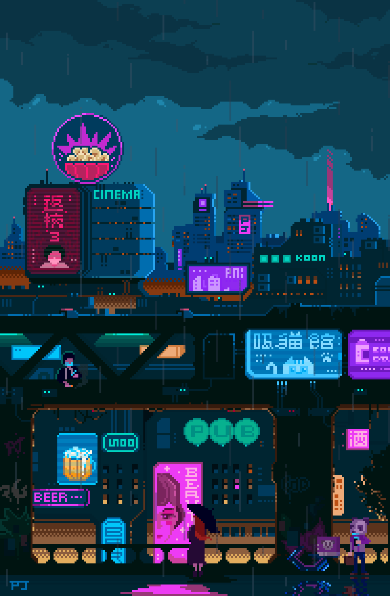

  

<h1 align="center">👋 Hi, I'm Vedant Patil</h1>

<table align="center">
  <tr>
    <td width="50%" valign="top">

### 👨‍💻 About Me

I'm a **full-stack developer and AI/ML enthusiast** who enjoys building products, solving problems, and exploring practical uses for AI.

- 💼 Working at **RefactorFactory**
- 🔭 Building **Restro** and AI-powered systems
- 🌱 Learning about **deep learning and neural networks**
- 🤖 Exploring **LLMs, RAG, embeddings, and AI pipelines**
- 💬 Ask me about **React, Next.js, Node.js, Python, machine learning, and AI**
- ⚡ I enjoy building things and figuring out how they work

    </td>
    <td width="50%" align="center" valign="middle">
      
    </td>
  </tr>
</table>

---

## 🚀 Projects and Work

- 🍽️ **Restro** — A restaurant management and ordering platform
- 🤖 **Redrob AI** — A system for intelligent candidate discovery and ranking
- 🎙️ **VoiceX** — An AI-powered voice project
- 🏢 **RefactorFactory** — Building software products and AI solutions

---

## 🛠️ Tech Stack

### 💻 Development

  
  
  
  
  
  
  

### 🤖 AI & Machine Learning

  
  
  
  
  
  
  

**Focus:** Deep learning · LLMs · Embeddings · RAG · Semantic search

### 🧠 AI Engineering

**LLM applications** · **RAG pipelines** · **Vector search** · **Hybrid retrieval** · **Knowledge graphs**

FAISS · BM25 · Cross-encoders · Learning to rank · SHAP · LangChain

### 🗄️ Backend & Data

  
  
  
  
  

REST APIs · Authentication · Webhooks · Payments · Server-side systems

### ☁️ Cloud & DevOps

  
  
  
  
  
  

